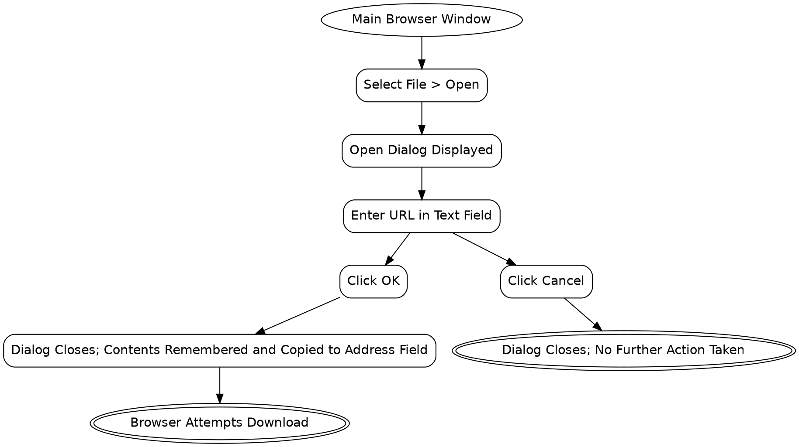

```text
1. Main Browser Window → Select File > Open → Open Dialog Displayed → Enter URL in Text Field → Click OK → Dialog Closes; Contents Remembered and Copied to Address Field → Browser Attempts Download
2. Main Browser Window → Select File > Open → Open Dialog Displayed → Enter URL in Text Field → Click Cancel → Dialog Closes; No Further Action Taken
```