```dot
digraph B12_FileOpen {
  rankdir=LR;
  node [shape=box, fontname="Helvetica"];

  // Entry/idle state; also the state execution returns to after either branch completes
  n1 [label="Main Browser Window", peripheries=2];

  // Requirement: pop-up dialog with text field, OK button, Cancel button, and prompt text
  n2 [label="Open Dialog Displayed", shape=diamond];

  // OK branch - each clause of the requirement sentence becomes one checkable node
  n3 [label="Dialog Closed (OK)"];
  n4 [label="Text Field Contents Remembered"];
  n5 [label="Address Field Updated"];
  n6 [label="Download Attempted"];

  // Cancel branch
  n7 [label="Dialog Closed (Cancel)"];
  n8 [label="No Further Action Taken"];

  n1 -> n2 [label="select File -> Open"];
  n2 -> n3 [label="press OK"];
  n2 -> n7 [label="press Cancel"];
  n3 -> n4 [label="remember text field contents"];
  n4 -> n5 [label="copy contents to address field"];
  n5 -> n6 [label="attempt to download resource"];
  n6 -> n1 [label="ready for next command"];
  n7 -> n8 [label="no action re: Open command"];
  n8 -> n1 [label="ready for next command"];
}
```

```text
1. Main Browser Window → Open Dialog Displayed → Dialog Closed (OK) → Text Field Contents Remembered → Address Field Updated → Download Attempted → Main Browser Window
2. Main Browser Window → Open Dialog Displayed → Dialog Closed (Cancel) → No Further Action Taken → Main Browser Window
```