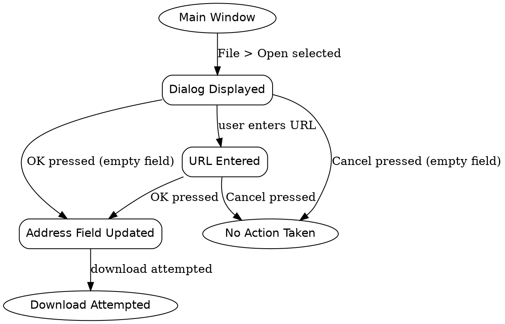

```text
1. Main Window → Dialog Displayed → Address Field Updated → Download Attempted
2. Main Window → Dialog Displayed → URL Entered → Address Field Updated → Download Attempted
3. Main Window → Dialog Displayed → No Action Taken
4. Main Window → Dialog Displayed → URL Entered → No Action Taken
```