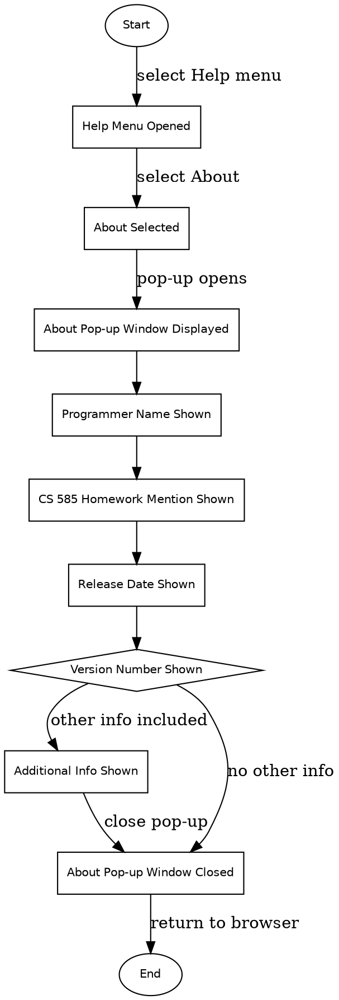

```text
1. Start → Help Menu Opened → About Selected → About Pop-up Window Displayed → Programmer Name Shown → CS 585 Homework Mention Shown → Release Date Shown → Version Number Shown → Additional Info Shown → About Pop-up Window Closed → End
2. Start → Help Menu Opened → About Selected → About Pop-up Window Displayed → Programmer Name Shown → CS 585 Homework Mention Shown → Release Date Shown → Version Number Shown → About Pop-up Window Closed → End
```