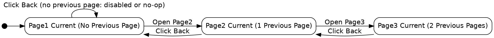

```text
1. Page1 Current (No Previous Page) → Page1 Current (No Previous Page)
2. Page1 Current (No Previous Page) → Page2 Current (1 Previous Page) → Page1 Current (No Previous Page)
3. Page1 Current (No Previous Page) → Page2 Current (1 Previous Page) → Page3 Current (2 Previous Pages) → Page2 Current (1 Previous Page) → Page1 Current (No Previous Page)
```