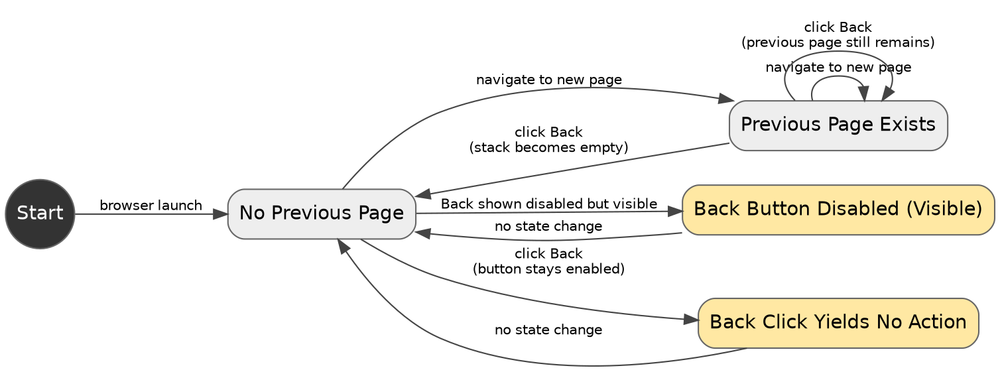

```text
1. Start → No Previous Page → Previous Page Exists → Previous Page Exists → Previous Page Exists → No Previous Page → Back Button Disabled (Visible) → No Previous Page
2. Start → No Previous Page → Back Click Yields No Action → No Previous Page
```