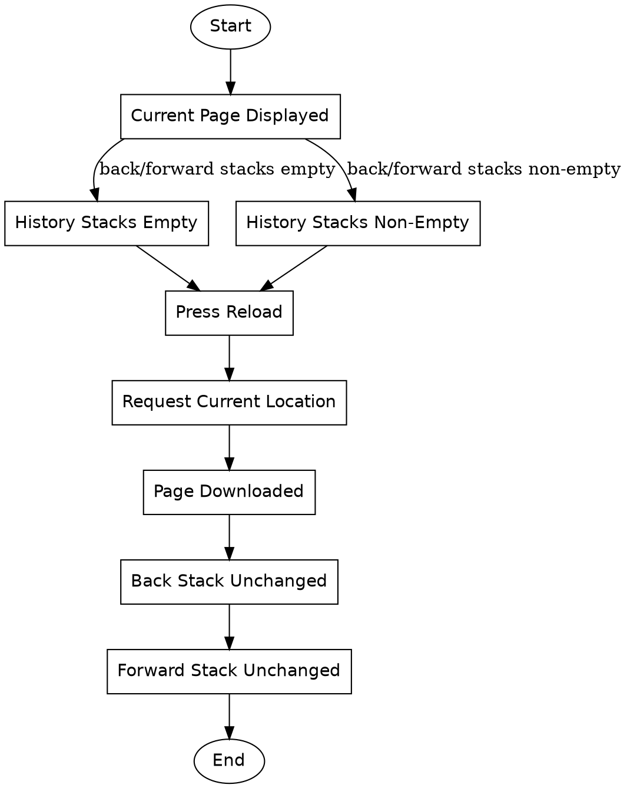

```text
1. Start → Current Page Displayed → History Stacks Empty → Press Reload → Request Current Location → Page Downloaded → Back Stack Unchanged → Forward Stack Unchanged → End
2. Start → Current Page Displayed → History Stacks Non-Empty → Press Reload → Request Current Location → Page Downloaded → Back Stack Unchanged → Forward Stack Unchanged → End
```