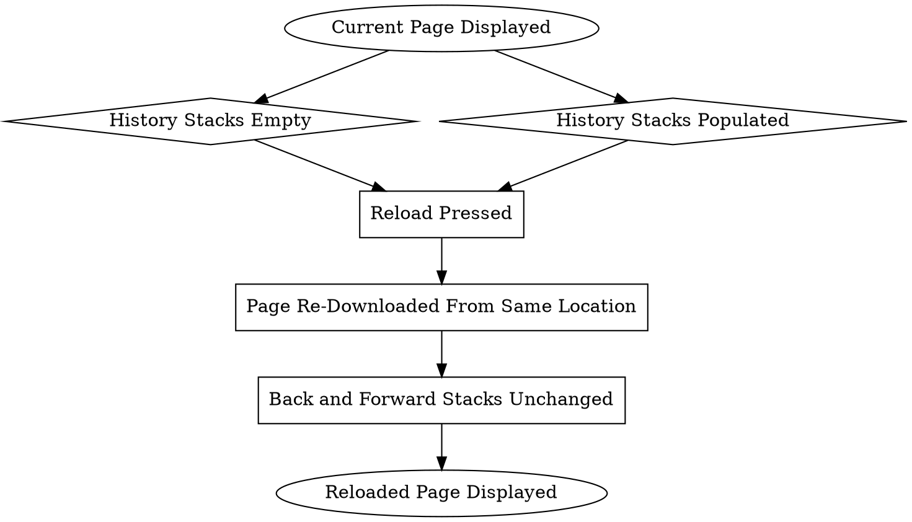

```text
1. Current Page Displayed → History Stacks Empty → Reload Pressed → Page Re-Downloaded From Same Location → Back and Forward Stacks Unchanged → Reloaded Page Displayed
2. Current Page Displayed → History Stacks Populated → Reload Pressed → Page Re-Downloaded From Same Location → Back and Forward Stacks Unchanged → Reloaded Page Displayed
```