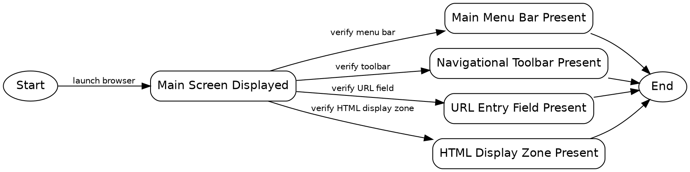

```text
1. Start → Main Screen Displayed → Main Menu Bar Present → End
2. Start → Main Screen Displayed → Navigational Toolbar Present → End
3. Start → Main Screen Displayed → URL Entry Field Present → End
4. Start → Main Screen Displayed → HTML Display Zone Present → End
```