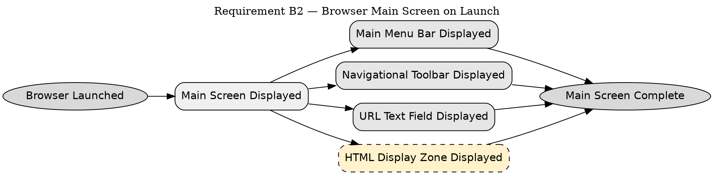

```text
1. Browser Launched → Main Screen Displayed → Main Menu Bar Displayed → Main Screen Complete
2. Browser Launched → Main Screen Displayed → Navigational Toolbar Displayed → Main Screen Complete
3. Browser Launched → Main Screen Displayed → URL Text Field Displayed → Main Screen Complete
4. Browser Launched → Main Screen Displayed → HTML Display Zone Displayed → Main Screen Complete
```