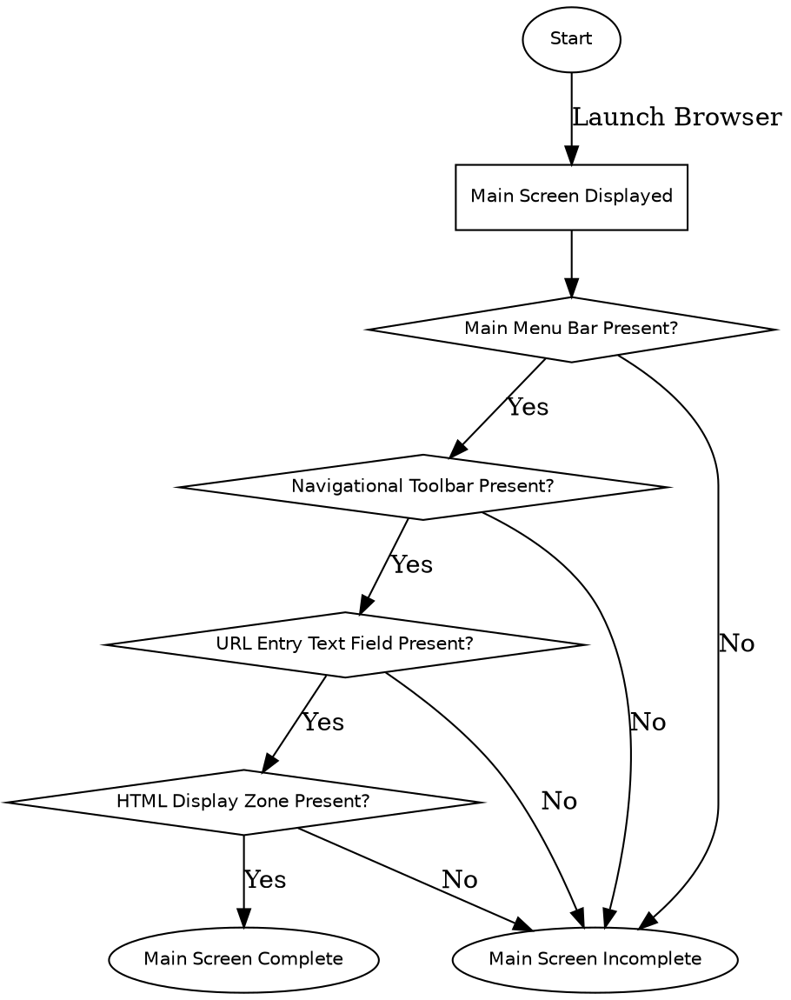

```text
1. Start → Main Screen Displayed → Main Menu Bar Present? → Navigational Toolbar Present? → URL Entry Text Field Present? → HTML Display Zone Present? → Main Screen Complete
2. Start → Main Screen Displayed → Main Menu Bar Present? → Main Screen Incomplete
3. Start → Main Screen Displayed → Main Menu Bar Present? → Navigational Toolbar Present? → Main Screen Incomplete
4. Start → Main Screen Displayed → Main Menu Bar Present? → Navigational Toolbar Present? → URL Entry Text Field Present? → Main Screen Incomplete
5. Start → Main Screen Displayed → Main Menu Bar Present? → Navigational Toolbar Present? → URL Entry Text Field Present? → HTML Display Zone Present? → Main Screen Incomplete
```