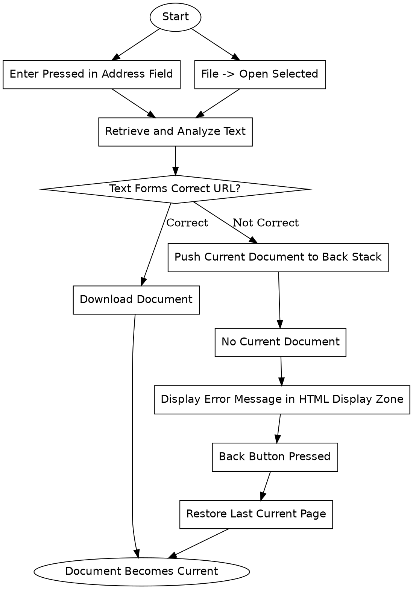

```text
1. Start → Enter Pressed in Address Field → Retrieve and Analyze Text → Text Forms Correct URL? → Download Document → Document Becomes Current
2. Start → Enter Pressed in Address Field → Retrieve and Analyze Text → Text Forms Correct URL? → Push Current Document to Back Stack → No Current Document → Display Error Message in HTML Display Zone → Back Button Pressed → Restore Last Current Page → Document Becomes Current
3. Start → File -> Open Selected → Retrieve and Analyze Text → Text Forms Correct URL? → Download Document → Document Becomes Current
4. Start → File -> Open Selected → Retrieve and Analyze Text → Text Forms Correct URL? → Push Current Document to Back Stack → No Current Document → Display Error Message in HTML Display Zone → Back Button Pressed → Restore Last Current Page → Document Becomes Current
```