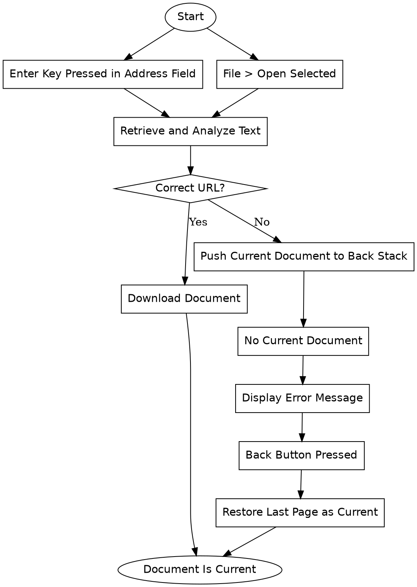

```text
1. Start → Enter Key Pressed in Address Field → Retrieve and Analyze Text → Correct URL? → Download Document → Document Is Current
2. Start → Enter Key Pressed in Address Field → Retrieve and Analyze Text → Correct URL? → Push Current Document to Back Stack → No Current Document → Display Error Message → Back Button Pressed → Restore Last Page as Current → Document Is Current
3. Start → File > Open Selected → Retrieve and Analyze Text → Correct URL? → Download Document → Document Is Current
4. Start → File > Open Selected → Retrieve and Analyze Text → Correct URL? → Push Current Document to Back Stack → No Current Document → Display Error Message → Back Button Pressed → Restore Last Page as Current → Document Is Current
```