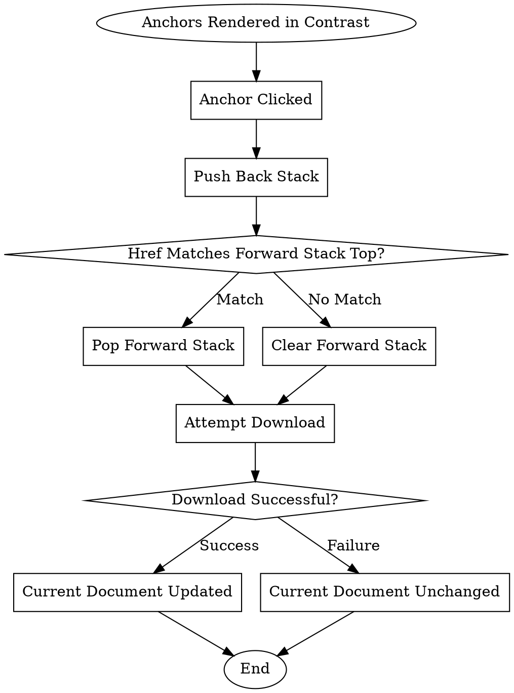

```text
1. Anchors Rendered in Contrast → Anchor Clicked → Push Back Stack → Href Matches Forward Stack Top? → Pop Forward Stack → Attempt Download → Download Successful? → Current Document Updated → End
2. Anchors Rendered in Contrast → Anchor Clicked → Push Back Stack → Href Matches Forward Stack Top? → Pop Forward Stack → Attempt Download → Download Successful? → Current Document Unchanged → End
3. Anchors Rendered in Contrast → Anchor Clicked → Push Back Stack → Href Matches Forward Stack Top? → Clear Forward Stack → Attempt Download → Download Successful? → Current Document Updated → End
4. Anchors Rendered in Contrast → Anchor Clicked → Push Back Stack → Href Matches Forward Stack Top? → Clear Forward Stack → Attempt Download → Download Successful? → Current Document Unchanged → End
```