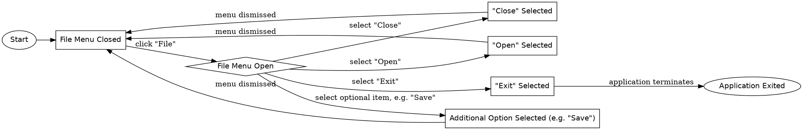

```text
1. Start → File Menu Closed → File Menu Open → "Open" Selected → File Menu Closed
2. Start → File Menu Closed → File Menu Open → "Close" Selected → File Menu Closed
3. Start → File Menu Closed → File Menu Open → Additional Option Selected (e.g. "Save") → File Menu Closed
4. Start → File Menu Closed → File Menu Open → "Exit" Selected → Application Exited
```