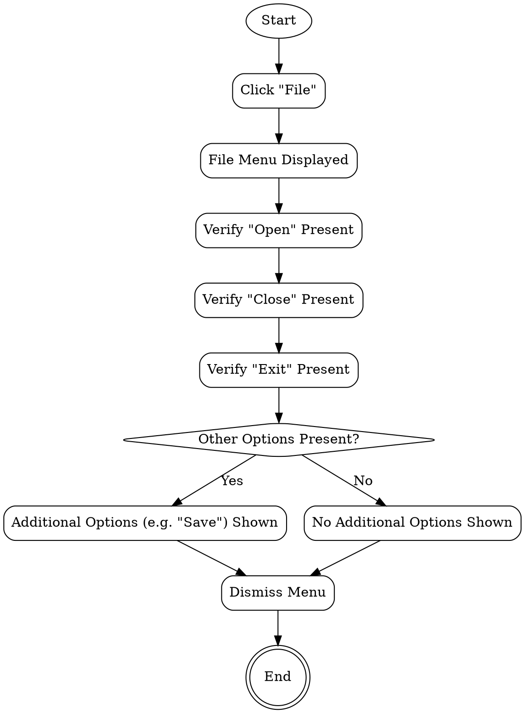

```text
1. Start → Click "File" → File Menu Displayed → Verify "Open" Present → Verify "Close" Present → Verify "Exit" Present → Other Options Present? → Additional Options (e.g. "Save") Shown → Dismiss Menu → End
2. Start → Click "File" → File Menu Displayed → Verify "Open" Present → Verify "Close" Present → Verify "Exit" Present → Other Options Present? → No Additional Options Shown → Dismiss Menu → End
```