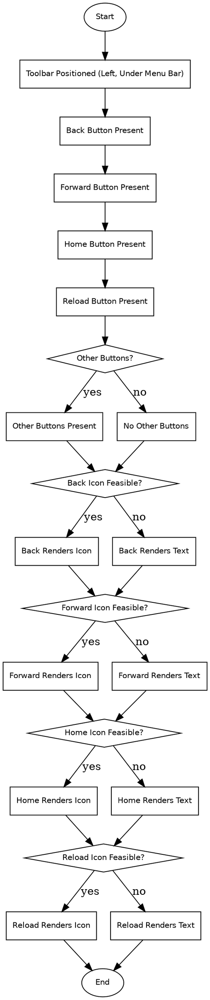

```text
1. Start → Toolbar Positioned (Left, Under Menu Bar) → Back Button Present → Forward Button Present → Home Button Present → Reload Button Present → Other Buttons? → Other Buttons Present → Back Icon Feasible? → Back Renders Icon → Forward Icon Feasible? → Forward Renders Icon → Home Icon Feasible? → Home Renders Icon → Reload Icon Feasible? → Reload Renders Icon → End
2. Start → Toolbar Positioned (Left, Under Menu Bar) → Back Button Present → Forward Button Present → Home Button Present → Reload Button Present → Other Buttons? → No Other Buttons → Back Icon Feasible? → Back Renders Text → Forward Icon Feasible? → Forward Renders Text → Home Icon Feasible? → Home Renders Text → Reload Icon Feasible? → Reload Renders Text → End
```