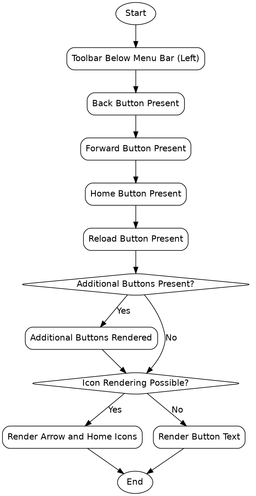

```text
1. Start → Toolbar Below Menu Bar (Left) → Back Button Present → Forward Button Present → Home Button Present → Reload Button Present → Additional Buttons Present? → Additional Buttons Rendered → Icon Rendering Possible? → Render Arrow and Home Icons → End
2. Start → Toolbar Below Menu Bar (Left) → Back Button Present → Forward Button Present → Home Button Present → Reload Button Present → Additional Buttons Present? → Icon Rendering Possible? → Render Button Text → End
```