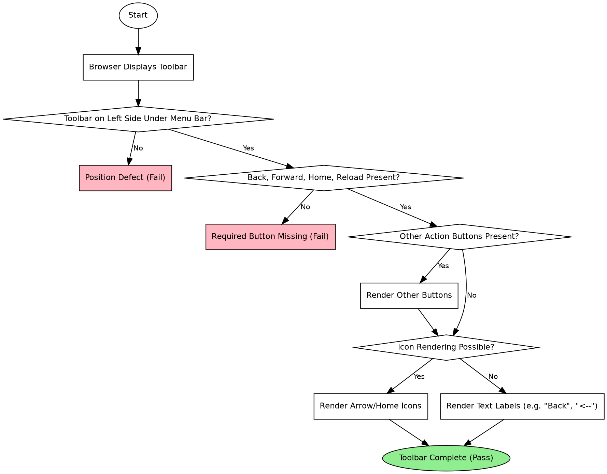

```text
1. Start → Browser Displays Toolbar → Toolbar on Left Side Under Menu Bar? → Position Defect (Fail)
2. Start → Browser Displays Toolbar → Toolbar on Left Side Under Menu Bar? → Back, Forward, Home, Reload Present? → Required Button Missing (Fail)
3. Start → Browser Displays Toolbar → Toolbar on Left Side Under Menu Bar? → Back, Forward, Home, Reload Present? → Other Action Buttons Present? → Icon Rendering Possible? → Render Arrow/Home Icons → Toolbar Complete (Pass)
4. Start → Browser Displays Toolbar → Toolbar on Left Side Under Menu Bar? → Back, Forward, Home, Reload Present? → Other Action Buttons Present? → Render Other Buttons → Icon Rendering Possible? → Render Text Labels (e.g. "Back", "<--") → Toolbar Complete (Pass)
```